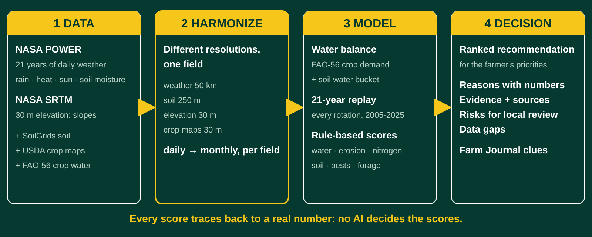
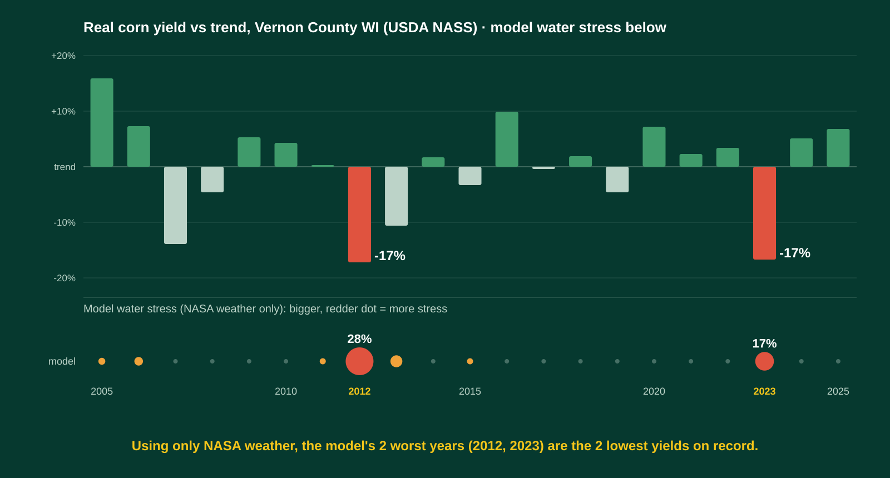

# ASTRATERRA

**A decision-support tool that replays your field's last 21 years to compare crop rotations.**

NASA Space Apps Challenge 2026 · Challenge: *Adapting farms with NASA data* (crop rotations for soil health and resilience)

A farmer picks a field on a map, answers a short (optional) soil and crop survey, and sets what matters most: saving water, soil health, profit or forage. ASTRATERRA combines **NASA Earth observations** with soil maps, crop science and the farmer's own knowledge, then compares the **current rotation with four alternatives**. Each one is **replayed through every year from 2005 to 2025** and explained: why it was suggested, the evidence, the benefits, the data gaps, and the risks to check with local experts.

> ASTRATERRA supports farmer judgment; it never replaces it.

<!-- Add a screenshot of the report here, e.g.  -->

---

## The problem

In southwestern Wisconsin's Driftless Area the land is steep: bare soil on slopes erodes quickly in heavy rain. The same county also had two severe drought seasons in twelve years (2012 and 2023, when corn yields fell about 17% below trend). Choosing a rotation means trading this year's harvest against water risk and the long-term health of the soil, and those trade-offs depend on each field's own weather, slope and soil.

**How can a farmer choose a rotation that manages water stress, protects vulnerable soil and stays productive, for their specific field?**

## What ASTRATERRA does

| Feature | What the farmer sees |
|---|---|
| **21-year replay** | Every rotation is run through each year 2005-2025 with real NASA weather: OK (under 15% water shortfall), stress (15-34%), failed (35%+). Click a year to see the soil water run dry month by month. |
| **Field risk map** | Erosion-prone slopes and low spots where cold air can collect (a terrain-based frost hint, not a measurement), mapped from NASA SRTM elevation on a satellite view. |
| **Explained recommendation** | The best fit for the farmer's priorities, with the reasons (in numbers), the trade-offs, and a breakdown of what the fit score is made of. |
| **Rotation cards** | Current rotation + 4 alternatives (cover crop, small grain + legume, perennial forage, drought-tolerant sorghum), each with why / evidence / benefits / data gaps / risks for local review / sources / confidence. |
| **Field analysis** | Rain vs. crop water demand by month, frost dates, heat days, heavy-rain days, sunshine, growing degree days, soil moisture vs. normal. |
| **Bare-field calendar** | Months the soil is unprotected, compared with the heavy-rain months when erosion is worst. |
| **Soil auto-fill + survey** | Clay, sand, organic carbon and pH filled in from soil maps; the farmer can correct any value or answer "I don't know". |
| **Real crop history** | The field's actual crops 2008-2025 from USDA satellite crop maps; the current rotation is detected automatically. |
| **Farm Journal** | The farmer logs each season (crop, planting/harvest months, outcome, notes). Simple rules spot patterns (soil pH, dry summers, a crop following itself, repeated failures in one plant family) and suggest causes to check. Stored only in the browser. |

## How it works



1. **Data.** For the selected point the backend fetches, in parallel: 21 years of daily NASA POWER weather, a 9 × 9 grid of NASA SRTM elevations, SoilGrids soil properties (0-100 cm) and the USDA Cropland Data Layer history. Each source is cached after the first request.
2. **Harmonize.** Weather (~50 km grid), soil (250 m) and elevation and crop maps (30 m) are brought to one field and from daily to monthly values.
3. **Model.**
   - Reference evapotranspiration with the Hargreaves equation (FAO-56, eq. 52).
   - Monthly crop water demand from FAO-56 crop coefficients (Kc curves built from each crop's planting window and growth stages).
   - A soil water "bucket": plant-available water per metre from soil texture (Saxton & Rawls, 2006) × the crop's effective root depth. The crop is stressed below 50% of available water (FAO-56).
   - Every rotation is replayed year by year, carrying soil water from one year to the next.
   - **Year types (machine learning):** k-means clustering groups the 21 summers into *hot/dry*, *normal* and *wet/cool* using summer rain, summer maximum temperature and root-zone soil moisture (standardized so each counts equally). We chose k-means because it is simple, works on small data and its groups are easy to explain; on the Wisconsin demo farm 2012 and 2023 fall in the hot/dry group. With only 21 years the groups are indicative, not definitive.
   - **Climate trends:** a Mann-Kendall test and Sen's slope on nine yearly values (summer highs, rain, heat days, soil moisture, growing-season heat, frost dates). Only statistically significant trends (p < 0.05) are reported as trends; on the Wisconsin farm year-to-year swings are larger than any 21-year trend, while in Iowa the frost-free season is lengthening about 10 days per decade.
   - Slope and low spots come from the elevation grid (USDA slope classes for erosion levels).
4. **Decision.** Rule-based scores (water, bare months, erosion, nitrogen, organic matter, pest-cycle breaks, forage) are weighted by the farmer's priorities; rotations that need equipment the farmer lacks are excluded from the recommendation. Every sentence shown is generated from these numbers, so every claim traces back to a value and its source. **No AI model decides the scores.**

## Validation



We compared the model's water stress with **USDA NASS county corn yields** for Vernon County, Wisconsin (2005-2025). The model only uses NASA weather, never the yields. Yields were detrended with a linear trend.

- The model's **two worst drought years for corn (2012, 2023) are the two lowest corn yields** in the county record (both about **17% below trend**).
- Rank correlation between stress and yield: -0.31 for corn, -0.25 for soybean: the right direction, moderate strength, as expected for a drought-only model.
- **Limits:** the model detects drought losses; losses from flooding, hail, cold or disease are outside its scope (for example 2007-2008). Monthly time steps can overstate stress when late-summer rain helps a crop recover (soybean in 2012: model 38% stress, real yield only 5% below trend).

Reproduce: `python astraterra-kit/backend/validate.py` (data in `astraterra-kit/data/validation/`).

## Data sources

| Source | Provider | Used for | Terms |
|---|---|---|---|
| [NASA POWER](https://power.larc.nasa.gov/) (agroclimatology) | NASA | Daily temperature, rain, solar radiation, humidity, root-zone soil wetness 2005-2025 | NASA open data. Soil wetness is MERRA-2 model output, not a direct satellite measurement |
| [SRTM 30 m](https://www.earthdata.nasa.gov/data/instruments/srtm) via [OpenTopoData](https://www.opentopodata.org/) | NASA | Elevation, slope, low spots | NASA open data; OpenTopoData public API limits respected and results cached |
| [SoilGrids 2.0](https://www.isric.org/explore/soilgrids) | ISRIC | Clay, sand, organic carbon, pH | CC-BY 4.0: "Soil data: SoilGrids 2.0, ISRIC World Soil Information" |
| [Cropland Data Layer](https://nassgeodata.gmu.edu/CropScape/) | USDA NASS | Crop history of the field 2008-2025 (US only) | Public domain |
| [Quick Stats](https://quickstats.nass.usda.gov/) | USDA NASS | County yields for validation | Public domain |
| [FAO-56](https://www.fao.org/4/x0490e/x0490e00.htm) | FAO | ET0, crop coefficients, root depths, stress threshold | Methodology |
| Crop database | Team research (Iowa State Extension, NRCS, FAO-56; sources per crop) | Planting windows, Kc stages, root depths, pH ranges, rotation templates | `astraterra-kit/data/crops/crops.csv`, `astraterra-kit/data/rotations/templates.json` |

Full list, methods and AI tools: [astraterra-kit/docs/TOOLS_LOG.md](astraterra-kit/docs/TOOLS_LOG.md).

## Run it locally

Requirements: Python 3.11+ and Node.js 18+.

**Backend** (from `astraterra-kit/backend`):
```bash
python -m venv .venv
.venv\Scripts\activate          # Windows  (macOS/Linux: source .venv/bin/activate)
pip install -r requirements.txt
uvicorn main:app --reload --port 8000
```
API docs: http://localhost:8000/docs · main endpoint `POST /api/analyze`, journal clues `POST /api/journal-clues`.

**Frontend** (from `astraterra-kit/frontend`, in a second terminal):
```bash
npm install
npm run dev
```
Open http://localhost:5173. The demo farms (Driftless Area WI 43.70767, -90.93877; Iowa 42.00, -93.70; Kansas 38.40, -97.55) are cached in the repo and load instantly; any other point is fetched live (about 10 seconds the first time).

## Repository map

- `astraterra-kit/backend/`: FastAPI app. `nasa_power.py`, `soil.py`, `terrain.py`, `cdl.py` (data), `features.py` (climate features, ET0, frost), `crop_data.py` + `crops.py` (crop database), `water_balance.py` (bucket model + replay), `rotations.py`, `scoring.py`, `explain.py`, `journal.py`, `validate.py`
- `astraterra-kit/frontend/`: React + Vite + Leaflet. Each feature is a module in `src/features/`
- `astraterra-kit/data/`: crop database, rotation templates, soil questionnaire, validation data, cached demo farms
- `astraterra-kit/docs/`: API contract, tools log, slide diagrams

## Limitations and next steps

- **Model scope:** drought stress only; no flooding, hail, disease or pest-pressure model. Monthly time steps; Hargreaves ET0 tends to overestimate in humid climates. One stress threshold for all crops.
- **Farming systems:** dryland fallow and irrigation are not modelled yet, so dry regions show unrealistic failures.
- **Data:** some crops still use placeholder values (listed in each card's data gaps). The **organic-matter and forage scores are heuristic indicators** based on team estimates, not sourced field data, and **profit uses placeholder values** until local prices and production costs are added. Water, erosion, bare-month, nitrogen and pest-break scores come from the model and the sourced crop database (`score_basis` in the API lists the basis of each score).
- **Next:** SMAP soil moisture, ECOSTRESS heat stress, GPM rainfall and MODIS NDVI (to verify bare months); flooding and fallow; local market prices; validation in more counties and crops.

## Team

- **Elaa:** backend, data pipeline, water model, scoring, climate trends, validation
- **Alex:** frontend, map and charts, guided flow
- **Robel:** agriculture research: crop database, rotation templates, soil questionnaire
- **Brandon:** k-means year-type clustering (machine learning)

**AI use:** Claude (Anthropic) assisted with planning, writing and explaining code, debugging and documentation; Cursor IDE assisted frontend development. All AI-assisted code was reviewed and tested by the team. Scores and recommendations are computed by deterministic rules, not by an AI model.
